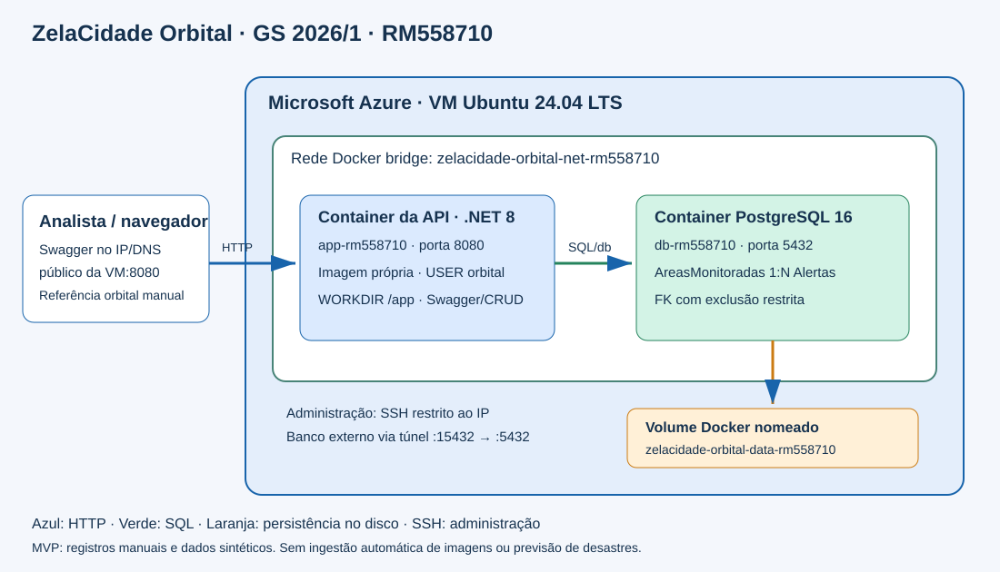

# ZelaCidade Orbital — Global Solution 2026/1

**DevOps Tools & Cloud Computing** · Diego Bassalo Canals Silva · RM558710 · 2TDSPG · Grupo ZelaCidade (individual).

## Proposta e limites do protótipo

Uma equipe municipal pode cadastrar áreas georreferenciadas e registrar alertas ambientais a partir da interpretação humana de observações de satélite. O vínculo entre área, fonte orbital e referência de observação ajuda a rastrear o motivo de uma inspeção em campo. A proposta conecta observação da Terra e economia espacial à prevenção de riscos urbanos.

Este MVP implementa **cadastro manual**, CRUD, validação, relacionamento e persistência. **Não baixa imagens de satélite, não detecta desastres automaticamente e não fornece previsão operacional.** As demonstrações usam dados sintéticos identificados como tais. Uma integração futura poderia consultar o catálogo Copernicus, manter a identificação da cena e submeter alertas à revisão humana.

Beneficiários: moradores e defesa civil. Operação: analista registra área/observação; equipe municipal revisa e atende o alerta. ODS 11 e 13: planejamento de cidades resilientes e adaptação a riscos climáticos. Indicadores propostos, ainda sem medição real: tempo entre registro e análise, percentual de alertas resolvidos e cobertura das áreas monitoradas. Referências: [Copernicus Data Space](https://dataspace.copernicus.eu/) e [ONU - ODS](https://sdgs.un.org/goals).

## Arquitetura macro na nuvem



O navegador acessa a API/Swagger na porta 8080 do IP ou DNS público da **VM Ubuntu Azure**. O container `zelacidade-orbital-app-rm558710` executa uma imagem própria .NET 8 com usuário **orbital**, sem privilégios root, e diretório `/app`. Ambos os containers usam a rede bridge nomeada `zelacidade-orbital-net-rm558710`. O nome DNS interno `db` aponta para PostgreSQL 16, que grava no volume nomeado `zelacidade-orbital-data-rm558710`. O volume fica no disco da VM, fora da camada descartável do container. Ele não é um backup e seria perdido com a exclusão do disco/volume.

O PostgreSQL publica a porta 5432 no host `127.0.0.1`; uma conexão externa de administração usa túnel SSH. A porta do banco não fica aberta indiscriminadamente na internet. No vídeo, os SELECTs são feitos diretamente com `docker container exec ... psql`.

Legenda: seta azul = HTTP externo; verde = SQL na rede Docker; laranja = arquivos persistentes; cinza = administração SSH. O diagrama representa implantação e componentes, não TOGAF.

## Links

- [GitHub deste semestre](https://github.com/DGMMX/gs-zelacidade-orbital-2026-1)
- [Swagger da VM](http://zelacidade-orbital-rm558710-dda0.eastus.cloudapp.azure.com:8080/swagger)
- [Prontidão da API/banco](http://zelacidade-orbital-rm558710-dda0.eastus.cloudapp.azure.com:8080/health/ready)
- Vídeo YouTube: **ainda não gravado**. Inserir o link real depois da publicação/revisão.

O link da VM depende de recursos ativos. Consulte `evidencias/ambiente.json` do pacote para o estado e a data da validação; existência de um endereço no README não certifica disponibilidade.

## How to: do clone aos testes na nuvem

### 1. Preparar uma VM Ubuntu 24.04 LTS

Na máquina Windows com Azure CLI, entre na assinatura Azure for Students de `RM558710@fiap.com.br`. O script abaixo cria recursos separados dos usados no 2º semestre. Exige quota Compute disponível; usa VM Standard_B2s, disco Standard SSD e IP público, que consomem crédito enquanto alocados. Não ativa Test Plans nem trial.

```powershell
az login
git clone https://github.com/DGMMX/gs-zelacidade-orbital-2026-1.git
cd gs-zelacidade-orbital-2026-1
powershell -ExecutionPolicy Bypass -File scripts/provisionar-vm.ps1
```

O script guarda chave privada em `.local/` e registra apenas dados não secretos em `evidencias/ambiente.json`. Se a VM já existir, ele a reutiliza. Não apaga recursos. A regra SSH é limitada ao IP de origem detectado; se sua rede mudar, atualize essa regra antes de conectar. Aguarde a conclusão do cloud-init.

### 2. Conectar por SSH e conferir Docker

```powershell
ssh -i .local/orbital_vm orbitaladmin@zelacidade-orbital-rm558710-dda0.eastus.cloudapp.azure.com
```

Na VM:

```bash
sudo cloud-init status --wait
docker --version
docker compose version
```

Se estiver usando outra VM, instale Docker com `sudo bash scripts/preparar-vm.sh` depois de clonar e reconecte para aplicar o grupo docker.

### 3. Começar a demonstração pelo clone, dentro da VM

O vídeo precisa mostrar o clone em uma pasta nova. Mesmo com o ambiente pronto, execute este início na gravação. Antes, encerre a implantação anterior com `docker compose stop` na pasta antiga, pois as portas e nomes são fixos; preserve o volume e **não use `down -v`**. Escolha uma pasta nova, por exemplo `demo-2026-1`, que ainda não exista.

```bash
git clone https://github.com/DGMMX/gs-zelacidade-orbital-2026-1.git demo-2026-1
cd demo-2026-1
bash scripts/preparar-env.sh
```

Se já existir um volume inicializado, use o mesmo `.env` da implantação anterior: copie-o por caminho local sem imprimir seu conteúdo e aplique `chmod 600 .env`. Gerar outra senha não muda a senha já armazenada no volume PostgreSQL. Para uma instalação nova sem volume existente, o script gera uma senha aleatória. Não mostre `.env`, connection strings ou chaves na gravação.

### 4. Construir a imagem e iniciar em segundo plano

```bash
docker compose up -d --build --wait --wait-timeout 180
docker compose ps
curl --fail http://127.0.0.1:8080/health/ready
```

O Compose aguarda o healthcheck do PostgreSQL antes de iniciar a API. O DDL em `scripts/script-bd.sql` é executado automaticamente **apenas na primeira inicialização de um volume vazio**. Para reaplicar os comandos idempotentes em volume já existente:

```bash
docker container exec -i zelacidade-orbital-db-rm558710 psql -X -U orbital -d orbital -v ON_ERROR_STOP=1 < scripts/script-bd.sql
```

### 5. Logs, terminal, usuário, portas, rede e volume

```bash
bash scripts/inspecionar-containers.sh
```

O script mostra `docker compose logs` dos dois serviços; entra em **cada** container com `docker container exec`; executa `pwd`, `ls -l`, `whoami`; demonstra usuário não root da aplicação, rede compartilhada, portas publicadas, volume nomeado, duas tabelas e chave estrangeira. Evita exibir variáveis secretas do Docker inspect.

### 6. CRUD e SELECT para cada operação

Abra o Swagger **do endereço público da VM**, não do seu computador local. Crie uma área e anote seu `id`. Use esse valor em `areaMonitoradaId` do alerta. Execute POST, GET, PUT e DELETE de cada tabela, alternando com SELECT **depois de cada operação**. Exclua o alerta antes da área.

Área de exemplo sintético:

```json
{"nome":"Area demonstrativa","municipio":"Sao Paulo","latitude":-23.550520,"longitude":-46.633308}
```

Alerta de exemplo sintético (trocar `1` pelo ID real da área):

```json
{"areaMonitoradaId":1,"titulo":"Risco ambiental demonstrativo","fonteOrbital":"Sentinel-2 - exemplo sintetico","referenciaObservacao":"DEMO: observacao manual, sem imagem baixada","status":"aberto"}
```

Para PUT, altere `nome` da área e `status` do alerta para `resolvido`. Caminhos: `/api/areas/`, `/api/areas/{id}`, `/api/alertas/`, `/api/alertas/{id}`. HTTP esperados: POST 201, GET/PUT 200, DELETE 204; GET após exclusão 404; exclusão da área que possui alerta 409.

Terminal da VM, depois de CADA operação, com o ID retornado pelo POST:

```bash
docker container exec zelacidade-orbital-db-rm558710 psql -X -U orbital -d orbital -c 'SELECT * FROM "AreasMonitoradas" WHERE "Id" = 1;'
docker container exec zelacidade-orbital-db-rm558710 psql -X -U orbital -d orbital -c 'SELECT * FROM "Alertas" WHERE "Id" = 1;'
```

Para também executar a verificação automatizada HTTP + SELECT, com dados próprios e teste de persistência após recriação dos dois containers:

```bash
python3 scripts/validar-nuvem.py --base-url http://zelacidade-orbital-rm558710-dda0.eastus.cloudapp.azure.com:8080 --testar-volume
```

O script registra oito operações com SELECT, casos de erro e persistência em `evidencias/crud-container.json`, e remove só os registros sintéticos que criou. O resultado da preparação não substitui o vídeo: mostre e explique as operações durante sua gravação. Recriar containers preserva o volume; **não execute `docker compose down -v`**.

### 7. Acesso administrativo externo ao banco

No computador Windows, com a chave privada local:

```powershell
ssh -i .local/orbital_vm -L 15432:127.0.0.1:5432 orbitaladmin@zelacidade-orbital-rm558710-dda0.eastus.cloudapp.azure.com
```

Com o túnel aberto, cliente PostgreSQL conecta em `127.0.0.1:15432`, usuário `orbital`, banco `orbital`, usando a senha do `.env` da VM. Esse endereço é a ponta local do túnel; API e banco executam efetivamente na nuvem.

## Requisitos e entrega

Referência do professor: PDF 2026/1, páginas **23–28**. App: Dockerfile próprio, `USER orbital`, `WORKDIR /app`, variável, porta 8080, nome com RM. Banco: PostgreSQL permitido, volume nomeado, variável, porta 5432, nome com RM. Ambos: mesma rede, `-d`, logs e terminal. Dados: duas tabelas com FK, CRUD e SELECT no container para cada operação.

O formato oficial solicitado é **PDF com capa, grupo, nomes/RMs, GitHub e YouTube**. O ZIP é um pacote separado de material solicitado pelo aluno. Sem vídeo, o PDF permanece **PRÉVIA — NÃO ENVIAR**. Grave tela com narração clara em pelo menos 720p, sem celular; evidencie todas as etapas desde o clone. A rubrica do 1º semestre orienta cuidado com cortes; prefira uma gravação contínua. O capitulo DevOps não fixa os limites de 3, 5 ou 8 minutos das outras disciplinas.

O enunciado original informa prazo em **09/06/2026 às 23h55** e apresentação de 10 a 16/06. Esses prazos já passaram na data de preparação atual; uma eventual reposição ou novo prazo depende do professor/Portal. Não foi obtida autorização de entrega fora de prazo nem realizado envio ao Portal.

## Uso de IA

ChatGPT/Codex auxiliou na elaboração da adaptação temática, código, infraestrutura, documentação e verificações. Os registros de teste correspondem a execuções reais quando indicados como aprovados; não representam detecção orbital real. Diego deve revisar o material e explicar arquitetura, funcionamento e comandos na apresentação.
